<p align="center">
  
</p>

# Awesome Cross-App Contextual Revenue Operations (RevOps) [](https://github.com/ishandutta2007/Awesome-Awesome-Awesome)

> 🚀 A comprehensive, curated directory of enterprise SaaS platforms and production-grade open-source tools for **Cross-App Contextual Revenue Operations (RevOps)**, AI-driven revenue intelligence, automated lead-to-revenue orchestration, and quote-to-cash data unification.

<p align="center">
  <a href="https://github.com/ishandutta2007/Awesome-Awesome-Awesome"></a><a href="https://discord.gg/jc4xtF58Ve"></a>
  <a href="https://github.com/ishandutta2007/Awesome-Cross-App-Contextual-Revenue-Operations"></a>
  <a href="http://makeapullrequest.com"></a>
  <a href="https://opensource.org/licenses/MIT"></a>
  <a href="https://github.com/ishandutta2007"></a>
</p>

🔄 **Cross-App Contextual Revenue Operations (RevOps)** breaks down silos across Customer Relationship Management (CRM), billing engines, product usage telemetry, marketing automation, and multi-channel customer interactions (email, video conferences, phone calls, support tickets). By persistently synchronizing live business context across tools (Salesforce, HubSpot, Stripe, PostHog, Slack, Snowflake), modern RevOps infrastructures surface high-intent buying signals, enforce deal hygiene, predict revenue outcomes, and automate end-to-end go-to-market workflows.

---

## 📑 Table of Contents

- [📊 Sector Overview & Market Dynamics](#-sector-overview--market-dynamics)
- [🏢 SaaS & Hosted Enterprise Platforms](#-saas--hosted-enterprise-platforms)
- [💻 Open-Source GitHub Projects](#-open-source-github-projects)
- [🏗️ Architecture & Implementation Blueprint](#️-architecture--implementation-blueprint)
- [🤝 How to Contribute](#-how-to-contribute)
- [💖 Support & Community](#-support--community)
- [⭐ Star History](#-star-history)
- [⚖️ Disclaimer & Best Practices](#️-disclaimer--best-practices)

---

## 📊 Sector Overview & Market Dynamics

The global **Revenue Operations (RevOps) platform market** is valued at approximately **$6.2B–$7.2B in 2025–2026** (scaling toward $16B+ at ~15% CAGR), with the specialized **Revenue Intelligence & Action Orchestration** segment contributing an additional **$3.8B–$4.8B**.

The market structure exhibits **moderate concentration at the top with heavy down-stack fragmentation**:
- **Consolidated Incumbents**: Foundation layers and enterprise reporting are concentrated among major CRM ecosystems (Salesforce, HubSpot, Microsoft Dynamics) and multi-billion-dollar conversation/revenue intelligence leaders (Gong, Clari).
- **Fragmented Innovation**: The operational layers—such as real-time signal detection, dynamic lead routing, CPQ, usage metering, and autonomous agent orchestration—remain deeply fragmented across point-solution startups and emerging self-hosted open-source technologies.

---

## 🏢 SaaS & Hosted Enterprise Platforms

A comparison of leading commercial Revenue Operations, conversation intelligence, and GTM orchestration platforms. Sorted by company valuation / scale (descending).

| Product | Valuation / Revenue | Starting Price | Free Tier / Free Trial Limits | Description |
| :--- | :--- | :--- | :--- | :--- |
| **[Gong](https://www.gong.io/)** | **~$4.5B Valuation** (Peak $7.25B; $500M+ ARR) | ~$100–$135 / user / month (billed annually, ~$1,200–$1,600/seat/yr + base platform fee) | **No free tier or public trial** (Custom demo & sales-guided POC sandbox only) | AI revenue intelligence platform capturing customer conversations across meetings, phone calls, and email to forecast deals and direct sales coaching. |
| **[Clari](https://www.clari.com/)** | **~$2.6B Valuation** (Series F; $500M+ total raised) | ~$90–$100 / user / month (Starts at ~$1,080/seat/yr billed annually) | **No free tier or public trial** (Available strictly via scheduled sales demonstration) | End-to-end revenue operations platform delivering AI-powered pipeline governance, forecast accuracy, deal risk inspection, and revenue cadence management. |
| **[Backstory (formerly People.ai)](https://backstory.ai/)** | **$1.1B Valuation** (~$62M–$78M ARR; $200M raised) | ~$50–$100 / user / month (Enterprise annual contracts with ~$23K/yr median spend) | **Freemium companion tool** (**PeopleGlass** free plan for individual CRM record updates; no free trial for enterprise suite) | Enterprise AI revenue intelligence platform automatically recording multi-channel touchpoints (email, calendar, chat) and resolving them to CRM opportunities. |
| **[LeanData](https://www.leandata.com/)** | **~$450M Valuation** (Series D; ~$66M raised) | $39 / user / month (Standard Edition billed annually; Advanced at $49/mo, Premium at $59/mo) | **No self-serve free tier or public trial** (Sales-assisted sandbox POCs available on request) | Salesforce-native revenue orchestration engine pioneer in lead-to-account matching, multi-touch attribution, automated routing, and account-based scheduling. |
| **[BoostUp](https://boostup.ai/)** | **$30M+ Est. Valuation** (Series A; $20M+ raised) | $79 / user / month (Base plan billed annually for forecasting and inspection) | **14-day free trial** (Sales-guided trial environment upon consultation request) | Front-line revenue operations and predictive forecasting platform featuring AI deal scoring, risk indicators, and automated activity capture. |
| **[RevOps](https://revops.io/)** *(Maxio)* | **Acquired by Maxio** ($100M+ ARR Parent) | $75 / user / month (Pro plan for up to 5 licensed users + 25 free collaborators) | **Free Forever plan available** (Max 5 users, 3 active approval workflows, 5 contract templates, standard email support) | Collaborative CPQ, deal desk, and quote-to-cash platform enabling automated approval workflows, co-terming, and billing sync for HubSpot and Salesforce. |
| **[Syncari](https://syncari.com/)** | **Growth Stage** (Series A; $23M+ raised) | $995 / month (Starter tier for multi-system data unification & sync) | **30-day free trial** (Full platform trial access with standard connectors on request) | Multidirectional data unification and workflow orchestration platform normalizing customer and revenue records across CRM, marketing, and billing systems. |
| **[Aviso](https://aviso.com/)** | **Growth Stage** ($50M+ raised) | ~$4,166 / month (~$50,000 / year base enterprise starting contract) | **No permanent free tier** (Custom enterprise pilot trial available upon request) | Predictive revenue operating system featuring AI forecasting, conversational analysis, deal risk alerting, and collaborative sales room functionality. |
| **[Fullcast](https://www.fullcast.com/)** | **Growth Stage** (Seed/Series A; $34M+ raised) | Custom enterprise quote (Estimated starting packages at ~$15,000 / year) | **No free tier or public trial** (1-on-1 guided live product walkthroughs only) | End-to-end GTM operations platform governing territory planning, quota allocation, automated sales routing, and commission execution. |
| **[MonetizeNow](https://www.monetizenow.com/)** | **Early Stage** ($15M+ raised) | Custom enterprise quote (Deployment-dependent, starting at ~$12,000 / year) | **No free tier or public trial** (Interactive sandbox demo environment provided during evaluation) | Modern quote-to-revenue infrastructure unifying CPQ, multi-attribute usage-based metering, contract management, and hybrid invoicing. |

---

## 💻 Open-Source GitHub Projects

Production-ready, self-hostable tools for building custom, vendor-independent revenue operations stacks, usage-based billing infrastructure, open CRMs, and event ETL pipelines. Sorted by GitHub star count (descending).

| Project | Stars | Focus & License | Description |
| :--- | :--- | :--- | :--- |
| **[n8n](https://github.com/n8n-io/n8n)** | [](https://github.com/n8n-io/n8n/stargazers) | Workflow Automation (Fair-code) | Advanced visual workflow automation platform with 400+ native connectors, custom JavaScript/Python execution, and webhook triggers for synchronizing CRM, billing, and team alerts. |
| **[Twenty](https://github.com/twentyhq/twenty)** | [](https://github.com/twentyhq/twenty/stargazers) | Open CRM (AGPL-3.0) | Modern, AI-first open-source alternative to Salesforce. Delivers extensible schema modeling, real-time collaboration, and bi-directional API sync across business tooling. |
| **[PostHog](https://github.com/posthog/posthog)** | [](https://github.com/posthog/posthog/stargazers) | Product Analytics & Signals (MIT) | Developer-centric product intelligence suite capturing user telemetry, feature adoption, and high-intent buying signals to feed warm leads directly to revenue teams. |
| **[ERPNext](https://github.com/frappe/erpnext)** | [](https://github.com/frappe/erpnext/stargazers) | ERP & Accounting (GPL-3.0) | Comprehensive open-source ERP system covering accounting, subscription invoicing, purchase orders, inventory, and ASC 606 compliant revenue recognition. |
| **[Activepieces](https://github.com/activepieces/activepieces)** | [](https://github.com/activepieces/activepieces/stargazers) | Automation & AI Agents (MIT) | No-code/code workflow orchestration platform equipped with hundreds of MCP-compatible integrations and autonomous agents to bridge sales, ops, and customer service. |
| **[Airbyte](https://github.com/airbytehq/airbyte)** | [](https://github.com/airbytehq/airbyte/stargazers) | Data Movement / ELT (ELv2) | Open data integration engine supporting 300+ connectors to sync HubSpot, Stripe, Salesforce, and Postgres into central data warehouses for revenue modeling. |
| **[Lago](https://github.com/getlago/lago)** | [](https://github.com/getlago/lago/stargazers) | Metering & Billing (AGPL-3.0) | Open-source metering and usage-based billing engine. Payment-agnostic (Stripe, Adyen), featuring revenue analytics, automated invoicing, customer portals, and Lago AI MCP server. |
| **[SuiteCRM](https://github.com/salesagility/SuiteCRM)** | [](https://github.com/salesagility/SuiteCRM/stargazers) | Enterprise CRM (GPL-3.0) | Battle-tested, enterprise-grade open-source CRM delivering account management, quote generation, sales pipeline tracking, and customer service ticketing. |
| **[Meteroid](https://github.com/meteroid-oss/meteroid)** | [](https://github.com/meteroid-oss/meteroid/stargazers) | CPQ & Billing Engine (AGPL-3.0) | High-performance Rust-based billing and pricing infrastructure supporting subscription management, usage calculations, quote-to-contract generation (CPQ), and revenue analytics. |
| **[OpenBRMS](https://github.com/openbrms/openbrms)** | [](https://github.com/openbrms/openbrms/stargazers) | Business Rules Engine (Apache-2.0) | Lightweight Quarkus and Java-based Business Rules Management System enabling dynamic lead routing logic, commission qualification policies, and discount approval thresholds. |
| **[eRev](https://github.com/ChipmunkRPA/eRev)** | [](https://github.com/ChipmunkRPA/eRev/stargazers) | Revenue Recognition (MIT) | Python and SQLite-backed automated revenue recognition engine compliant with ASC 606 & IFRS 15 standards, designed for automated reporting across BI platforms. |
| **[RevenueOS](https://github.com/unempyd/revenueos)** | [](https://github.com/unempyd/revenueos/stargazers) | RevOps Automation (MIT) | Self-hosted revenue operations platform with strict approval gates (*Discover → Approve → Execute → Measure*) ensuring automated GTM tasks require human sign-off. |
| **[revenue-recognition](https://github.com/antonio-backnotfront/revenue-recognition)** | [](https://github.com/antonio-backnotfront/revenue-recognition/stargazers) | Financial Recognition API (MIT) | ASP.NET Core REST API managing customer contract upfront payments, milestones, and amortized revenue recognition schedules. |
| **[revenue-ops-ai-assistant](https://github.com/mizcausevic-dev/revenue-ops-ai-assistant)** | [](https://github.com/mizcausevic-dev/revenue-ops-ai-assistant/stargazers) | AI Decision Support (MIT) | AI-assisted GTM decision backend coupling PostgreSQL SaaS schemas with LLM summaries to guide operators through customer churn risks and pipeline bottlenecks. |
| **[SSI Revenue Recognition](https://github.com/open-synergy/ssi-revenue-recognition)** | [](https://github.com/open-synergy/ssi-revenue-recognition/stargazers) | Odoo Module (AGPL-3.0) | Odoo Community Association (OCA) addon extending enterprise ERP with multi-contract performance obligation tracking and delivery-linked revenue recognition. |

---

## 🏗️ Architecture & Implementation Blueprint

To assemble a custom, enterprise-grade, and self-hosted RevOps pipeline without vendor lock-in, integrate the following modular layers:

```
+--------------------------------------------------------------------------+
|                       1. Ingestion & Event Capture                       |
|   PostHog (Product Telemetry)  +  Airbyte (ELT from CRM, Billing & Ads)  |
+--------------------------------------------------------------------------+
                                     |
                                     v
+--------------------------------------------------------------------------+
|                  2. Data Storage & Core System of Record                 |
|             Twenty (Open-Source CRM)  /  PostgreSQL Warehouse            |
+--------------------------------------------------------------------------+
                                     |
                                     v
+--------------------------------------------------------------------------+
|                 3. Logic, Orchestration & Approval Gates                 |
|     n8n / Activepieces (Orchestration)  +  OpenBRMS (Rules & Routing)    |
|               RevenueOS (Human-in-the-Loop Approval Engine)              |
+--------------------------------------------------------------------------+
                                     |
                                     v
+--------------------------------------------------------------------------+
|                       4. Monetization & Recognition                      |
|       Lago / Meteroid (CPQ & Invoicing)  +  eRev (ASC 606 Compliance)    |
+--------------------------------------------------------------------------+
```

1. **Ingestion & Signal Discovery**: Aggregate interaction signals across marketing landing pages, ad networks, and apps using **Airbyte** and **PostHog**.
2. **Contextual System of Record**: Normalize accounts, contacts, and deal stages in an open CRM such as **Twenty** or an enterprise relational database.
3. **Workflow & Approval Logic**: Execute multi-step routing using **n8n** or **Activepieces**, isolate business logic with **OpenBRMS**, and enforce approval checkpoints through **RevenueOS**.
4. **Billing & Financial Reporting**: Automate quote-to-cash using **Lago** or **Meteroid**, and enforce accounting standards (ASC 606 / IFRS 15) with **eRev**.

---

## 🤝 How to Contribute

Contributions are warmly encouraged! To propose a new SaaS platform, open-source project, or architectural update:

1. **Fork** this repository.
2. Create a new branch: `git checkout -b feature/add-new-tool`.
3. Add the project to the appropriate table in `README.md`:
   - Follow alphabetical or score order conventions.
   - For SaaS tools: include verified starting pricing and explicit free tier / trial terms.
   - For Open-Source tools: include the repository URL, valid star badge (`style=social&color=white`), and clear functional scope.
4. Open a pull request describing the tool's relevance to cross-app contextual revenue operations.

---

## 💖 Support & Community

Thank you for visiting and using this resource! If you find this curated ecosystem directory helpful in navigating the complex world of Revenue Operations, please consider supporting the project:

- ⭐ **Star this repository** to help others discover it.
- 🍴 **Fork it** and contribute updates, corrections, or newly launched tools.
- 📢 **Share it** with your RevOps peers, data engineers, and GTM teams on LinkedIn, Twitter, or Slack communities.
- ☕ **Sponsor / Buy a Coffee**: Support ongoing curation, open-source maintenance, and research via the [GitHub Sponsors Dashboard](https://github.com/sponsors/ishandutta2007).

Every bit of support keeps this community-driven directory accurate, up-to-date, and independent!

---

## ⭐ Star History

[](https://star-history.dera.page/#ishandutta2007/Awesome-Cross-App-Contextual-Revenue-Operations&type=date&legend=top-left)

---

## ⚖️ Disclaimer & Best Practices

- 🔍 **Independent Community Resource**: This repository is maintained for informational and architectural purposes; inclusion does not imply official endorsement.
- 🛡️ **Data Compliance**: Tools handling revenue transactions, customer pipeline data, or call recordings must comply with global privacy frameworks (GDPR, CCPA/CPRA, SOC 2 Type II, and PCI-DSS).
- 🚦 **Human-in-the-Loop Safeguards**: When deploying autonomous AI agents to initiate customer outreach or update CRM records, always establish approval gates to avoid erroneous billing actions or spam dispatches.

---

<p align="center">
  <sub>Maintained with ❤️ by the RevOps &amp; Data Engineering Community. Distributed under the MIT License.</sub>
</p>
